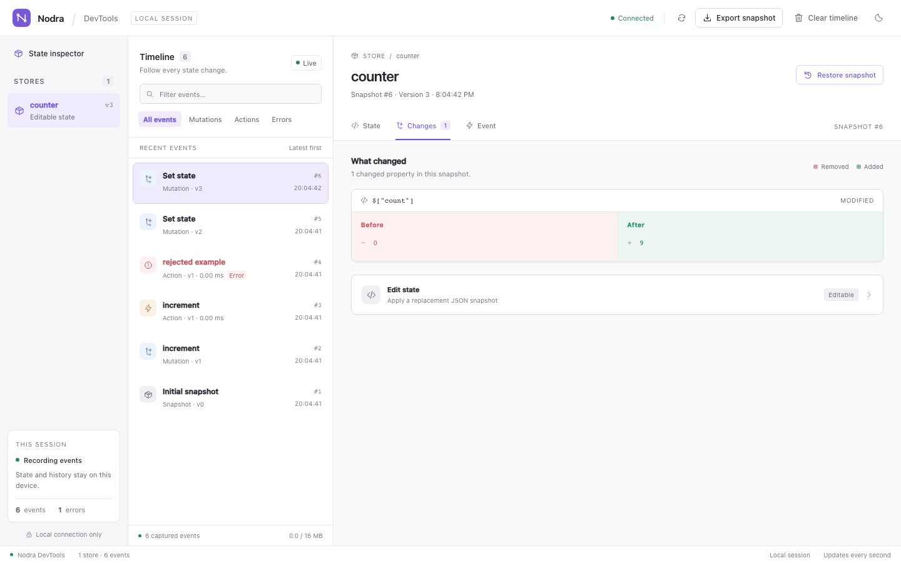
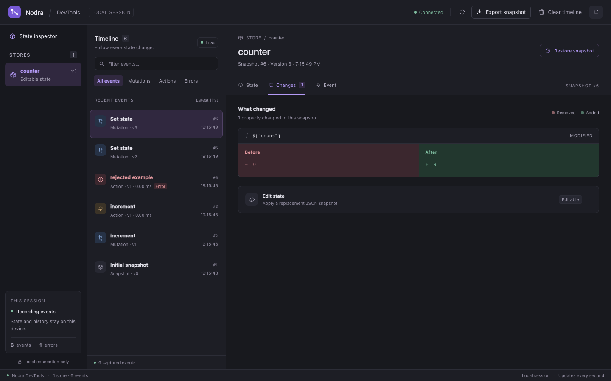
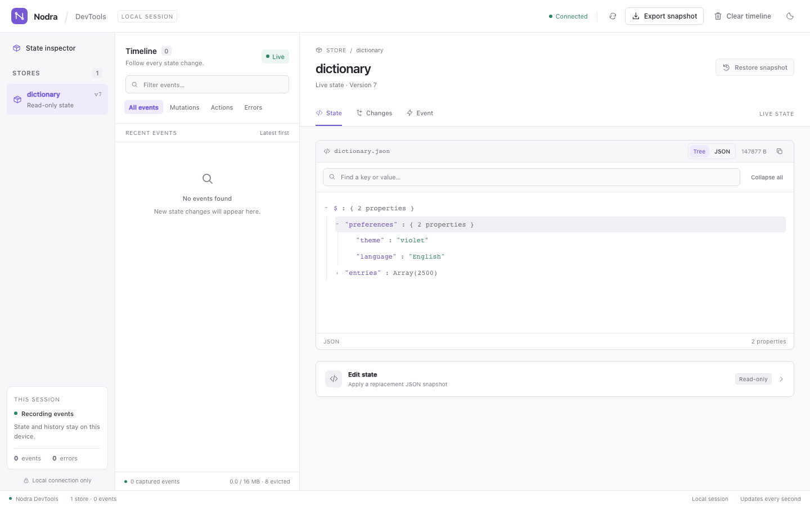
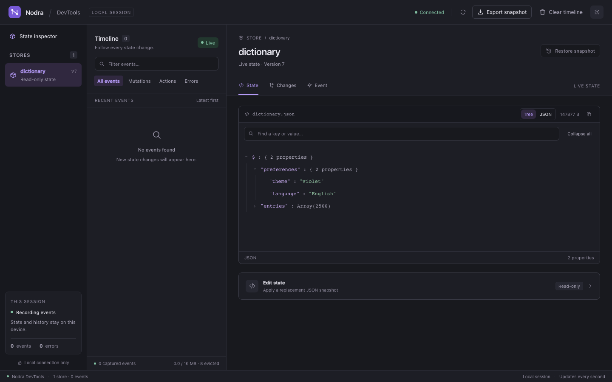

# Local DevTools

DevTools is an optional Go subpackage with an embedded browser inspector. There
is no frontend build step or runtime dependency on Node. Import it only in the
development configuration that should expose the inspector.

```go
inspector := devtools.New(devtools.Options{Limit: 300})
defer inspector.Close()
detach, err := devtools.Attach(inspector, "lookup", lookupStore)
if err != nil {
    return err
}
defer detach()
url, err := inspector.Listen()
if err != nil {
    return err
}
fmt.Println(url)
```

Listen binds an ephemeral port on `127.0.0.1` and returns a session URL. Open the
whole URL, including its fragment: the browser sends its capability as a bearer
header. The fragment is not part of HTTP requests or referrers. API routes reject
missing tokens, cross-origin requests and non-loopback Host values. State
responses are not cached; the UI loads only its embedded local CSS/JavaScript.
Close detaches all subscriptions and shuts down the listener. Each attach also
returns an idempotent detach function. IDs must be unique among current stores.

## Inspecting state and events

- The sidebar lists heterogeneous stores and their current source versions.
- The timeline records initial state, mutations (direct/patch/reset/action) and
  completed actions, with names, durations and errors. Failed actions appear
  without inventing a successful state mutation.
- State, Changes and Event panels show syntax-highlighted JSON with line numbers,
  side-by-side Before/After differences and event metadata. Copy JSON copies the complete captured state without line numbers, including rows not currently rendered. Arrow keys, Home and End switch tabs.
- Type filters narrow the timeline to mutations, actions or errors. Text search
  further matches event type, mutation type, action name and error text.
- Light and dark themes use the header toggle and remember the selection when
  browser storage is available. Narrow windows stack the inspector below history.
- Export snapshot downloads the current stores and retained event history as JSON.
- Clear timeline removes history while keeping attached stores and current state.

### Large state and retention

Switch State between JSON and Tree. Tree expands branches on demand, renders 100 children at a time and remembers expansion while the same store/event is selected. Collapse all closes branches; nesting beyond 40 levels is available through JSON or search. Key/value search traverses captured state independently of expanded branches, with up to 200 results and 50,000 visited nodes. The UI reports when a search limit is reached.

State and Event JSON initially render 1,000 lines; load another 1,000 with the button below. Lines longer than 2,000 characters are visibly shortened. Copy JSON and snapshot export retain the complete captured data. Changes compares at most 500 differences or 20,000 visited nodes and explicitly reports an incomplete comparison when capped.

`Options.MaxStateBytes` defaults to 1 MiB per encoded state after redaction. Oversize state becomes a visible inspection error and cannot be restored; it does not prevent the source update, and a later smaller value can recover. Encoding and redaction still run before this check, so the cap does not bound temporary encoding allocations.

History is bounded by both `Options.Limit` (200 events by default) and `Options.MaxHistoryBytes` (16 MiB). Oldest events are evicted to satisfy either limit. An event that alone exceeds the byte budget is discarded while the latest store state still advances. Exported `retention` and the timeline footer report accounted bytes, limits and dropped events. Byte accounting includes state/text payloads plus a fixed 256-byte metadata allowance per event; it is not an exact JSON export size or total process memory bound. Current states are retained separately, so attach a bounded number of stores. Clear resets the timeline accounting and dropped count.

Event sequence numbers describe capture order; concurrent mutation callbacks can arrive out of source-version order. The current state only advances to the highest captured version. Action metadata includes the version observed at notification time; its state panel is explicitly live rather than a snapshot of the action. Updates during initial registration may coalesce into a catch-up snapshot.

Snapshots are independent JSON buffers. Unsupported JSON types and redaction
errors appear as inspection errors without preventing store updates. Capturing
and serializing events runs on the notifying goroutine, so use the inspector
where development overhead is acceptable and keep source values immutable or
use NewWithClone.

## JSON editing and state restoration

Pass `AllowRestore: true` to opt in. The inspector then exposes Apply JSON state
and Restore snapshot. Both strictly decode into the attached store's Go type
before Set; malformed JSON, wrong types and unknown struct fields are rejected
without modifying state. Store subscriptions and persistence run normally.
Unsubmitted JSON edits survive polling, including after the editor loses focus.

Restoration creates a new source version and new events. It does not undo network
requests, file operations or other external effects of an action, and it does
not replay action functions. JSON cannot preserve unexported fields, pointer
identity or values excluded by json tags. Attach restorable state only when JSON
replacement is appropriate. An evicted event cannot be restored; an event from a
detached store cannot restore a new store later attached under the same ID,
including when replacement races snapshot restoration. An already-running Apply
may finish against its original store while that store is being detached.

## Redacting state

```go
inspector := devtools.New(devtools.Options{
    Redact: func(id string, raw json.RawMessage) (json.RawMessage, error) {
        var value map[string]any
        if err := json.Unmarshal(raw, &value); err != nil {
            return nil, err
        }
        delete(value, "token")
        return json.Marshal(value)
    },
})
```

Redact runs before JSON is retained, including both previous/current mutation values, initial state and catch-up snapshots. It must be concurrency-safe and return valid JSON. A state-redacted inspector is always read-only so masked state can never be restored.

Use `RedactMetadata` alongside the state filter when names, task keys or error text may be sensitive:

```go
RedactMetadata: func(id string, m devtools.Metadata) (devtools.Metadata, error) {
    m.Key = "[masked]"
    if m.Error != "" {
        m.Error = "Operation failed"
    }
    return m, nil
},
```

Metadata redaction runs outside inspector locks and must be concurrency-safe. It covers initial/catch-up state errors, mutation/action names and errors, task snapshots at attachment/resume, pending progress payloads, the timeline, Tasks, incremental/history APIs and full export. Callback errors and panics discard all original text and retain only `metadata redaction failed`; callback errors are never exported. Numeric action/run IDs and generations remain intact for correlation. Metadata-only redaction does not disable restoration because it does not alter state. Store IDs are not filtered: supply public labels. Session URLs and exported debug snapshots should stay with the intended development session. No automatic publishing or external telemetry is performed.

## Demo and browser verification

```sh
go run ./examples/devtools                 # read-only counter
go run ./examples/devtools -restore        # enable editing/restoration
```

The counter records a successful and rejected action, then increments once per
second. Use `-interval=1h` for a stable manual editing session.

Go tests cover capture, bounded history, independent exports, redaction, strict restoration, attachment generations, concurrent capture/close, authenticated API requests and listener shutdown. The optional Playwright smoke test drives the actual UI through inspection, error details, type/text filtering, clipboard copy, keyboard tabs, theme persistence, responsive layouts, state restoration, JSON validation, retained edits, export, diffs, clear and read-only mode. Rendering checks cover long identifiers, literal HTML strings, null snapshots, empty stores and disconnected sessions. Large-state fixtures exercise 2,500 records, lazy branch pagination, raw JSON pagination, search outside rendered rows, and explicit search/diff limits. CI runs it in headless Chromium:

```sh
# Install test tooling outside the repository; library users do not need Node.
npm install --prefix /tmp/nodra-browser --no-save --package-lock=false playwright@1.63.0
/tmp/nodra-browser/node_modules/.bin/playwright install chromium
PLAYWRIGHT_PATH=/tmp/nodra-browser/node_modules/playwright node scripts/devtools-smoke.mjs
```

`DEVTOOLS_CHROMIUM_PATH` can select an existing Chromium executable.
`DEVTOOLS_SCREENSHOT` optionally saves the exercised UI as a PNG.










## Incremental transport and paginated history

The browser polls `/api/changes` with a revision and event cursor, requesting at most 50 events at a time. Unchanged polls transmit no Store state or event payloads. Store IDs remove detached stores, source revisions select changed states, and a timeline epoch resets cached history after Clear. Initial connections receive the latest page; Load older events uses `/api/events`. New-event catch-up is paginated too. Oldest-retained sequence metadata removes evicted cached events. Both APIs return independent buffers and cap a page at 200 events. The authenticated `/api/snapshot` export remains complete even when the browser has loaded only one history page.

## Pause and sampling

Pause capture stops mutation/action retention while the source application continues running. It does not detach stores or remove retained history. Resume captures the current value of each attached Store, so the inspector catches up. A sampled policy records at most one mutation per Store per interval; action completions remain visible. `Options.SampleInterval` sets the initial interval, or use the Capture rate control and `SetCapture(paused, interval)`. Zero records every change. The UI shows paused/sampled status and skipped notification counts. Sampled current state may lag the source until another accepted capture, resuming, or disabling sampling.

Policy checks happen before JSON encoding/redaction; a notification already encoding can finish, but the recorder rechecks pause before retention. This reduces diagnostic encoding work, not the source Store's own cloning/notification cost. Capturing is still synchronous and full retained states still consume the configured byte budget. Sampling intentionally omits intermediate mutations and cannot serve as an audit log. Capture controls change only diagnostics, not application state; restoration remains separately opt-in.


## Task tracing

The Tasks tab shows queued/running work, progress, keys and retained outcomes for attached async-action sources. Selecting a task filters the timeline to its ActionID and source generation, linking progress to the resulting mutation and completion. Different actions can have the same local RunID; source ActionID disambiguates them. Current summaries are returned in Snapshot.Tasks and in incremental Changes only when TasksChanged is true. The idle poll still transmits no task summaries. Attaching during work captures the source's active-task snapshot.

Task summaries survive ordinary mutation-history eviction. Each attached source has a separate summary budget using Options.Limit and Options.MaxHistoryBytes; TasksDropped reports omitted summaries. These budgets are additional to mutation/event retention and current state payloads. Delayed traces cannot resurrect an evicted or completed summary. Clear resets both retained events and task summaries. Detaching removes current summaries for that generation.

Pause omits task diagnostics alongside other events; mutation sampling does not sample task lifecycle notifications. Resume reconciles current active tasks. If a previously captured task ended while capture was paused, its outcome is marked unobserved; the inspector cannot reconstruct success, cancellation or a committed version from an omitted event. Closed sources are labeled and cannot be restored. Use `RedactMetadata` to filter sensitive task keys, names and error text; the state Redact callback only filters state JSON.

Task cards display debounce, eligible queue wait, work and commit attempt durations in milliseconds, plus waiting/active worker counts sampled for that action. The same `metrics` object is retained in task summaries and action events and exported by every inspection API. Commit includes Store lock wait, clone/apply and synchronous mutation notifications; failures can still have a commit duration. Work excludes Before hooks. Other hooks/status callbacks are outside these phases, so their sum need not equal total duration. Counts describe the action at event publication, not a continuously sampled global queue.

Attach accepts Reader sources, including store.ReadOnly() and action.Status(). A read-only wrapper never acquires restoration capability, even when AllowRestore is true. Run `go run ./examples/workbench -devtools` for real native file search and settings-save task traces.

## Coalescing high-frequency task progress

`Options.TaskProgressInterval` optionally combines intermediate running progress per task. Zero retains every trace. For example, `devtools.New(devtools.Options{TaskProgressInterval: 100 * time.Millisecond})` records the running boundary immediately, retains only the newest progress in that interval, then publishes a trailing update even if no further report arrives. Queued/running transitions, terminal outcomes and error diagnostics remain immediate. A terminal trace cancels pending progress so a delayed timer cannot revive a completed task.

The source action/status streams remain unchanged; this is inspector retention control. At most one pending payload and timer exists per retained running summary. Pending payloads obey the event byte limit and total retained timer count follows the summary limit. Pause, Clear, detach, source closure and Inspector.Close cancel pending timers. Resume still reconciles active tasks and marks missed outcomes unobserved. The Tasks summary shows the number of progress reports folded into intervals; lifecycle events remain subject to the existing retention budgets.
